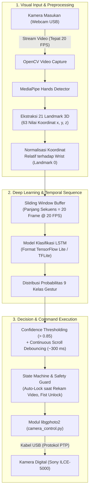

# Roadmap & Rencana Implementasi Tugas Akhir

**Judul Tugas Akhir:**  
> **KONTROL PARAMETER KAMERA BERBASIS HAND GESTURE MENGGUNAKAN MEDIAPIPE-LSTM PADA PERANGKAT EDGE**

* **Mahasiswa:** Hilmy Abid Syafi Abiyyu (NRP 5024 23 1029)  
* **Departemen:** Teknik Komputer FTEIC — Institut Teknologi Sepuluh Nopember (ITS), Surabaya  
* **Dosen Pembimbing:**  
  1. Dr. Eko Mulyanto Yuniarno, S.T., M.T.  
  2. Dr. Diah Puspito Wulandari, S.T., M.Sc.  

---

## 1. Status Progres Terkini (Baseline)

| Komponen / Fitur | Status | File / Modul Terkait | Keterangan Teknis |
| :--- | :---: | :--- | :--- |
| **Koneksi Kamera (Sony ILCE-5000)** | ✅ **Selesai** | [camera_control.py](file:///c:/Hilmy's/Git/camera-control-using-hand-gestures/camera_control.py) | Tersambung stabil via `usbipd` & WSL (libgphoto2), dilengkapi *auto-reconnect*. |
| **Kontrol Parameter Eksposur** | ✅ **Selesai** | [camera_control.py](file:///c:/Hilmy's/Git/camera-control-using-hand-gestures/camera_control.py) | Kontrol nilai **ISO**, **Aperture (f-number)**, dan **Shutter Speed** berhasil. |
| **Pengambilan Foto (*Capture*)** | ✅ **Selesai** | [camera_control.py](file:///c:/Hilmy's/Git/camera-control-using-hand-gestures/camera_control.py) | Menggunakan `trigger_capture()`, auto-download ke folder `hasil_jepretan/`. |
| **Perekaman Video (*Movie*)** | ✅ **Selesai** | [camera_control.py](file:///c:/Hilmy's/Git/camera-control-using-hand-gestures/camera_control.py) | Trigger *start/stop movie* pada kamera digital dan penyimpanan ke `hasil_rekaman/`. |
| **Kontrol Power Zoom** | ⏸️ **Bypass** | [camera_control.py](file:///c:/Hilmy's/Git/camera-control-using-hand-gestures/camera_control.py) | Firmware Sony A5000 membatasi eksekusi zoom via USB (sesuai batasan masalah #4). |
| **MediaPipe Hands Tracking** | ✅ **Selesai** | [test_hand_tracking.py](file:///c:/Hilmy's/Git/camera-control-using-hand-gestures/test_hand_tracking.py) | Pelacakan 21 landmark 3D real-time dengan koreksi orientasi tangan & mode mirror. |
| **Perangkat Lunak Koleksi Dataset** | ✅ **Selesai** | [data_collector.py](file:///c:/Hilmy's/Git/camera-control-using-hand-gestures/data_collector.py) | Full GUI 9 kelas, sampling rate 20 FPS (20 frame/sekuens), tombol hapus sampel (D), dan proteksi auto-cancel. |
| **Perekaman Dataset Mandiri** | ✅ **Baseline Aktif** | `raw_videos/` & `dataset/` | Baseline 189 sampel (21 sampel/kelas x 9 kelas) selesai; siap ditambah berkala. |
| **Pelatihan LSTM & Konversi TFLite**| ✅ **Selesai** | [train_lstm.py](file:///c:/Hilmy's/Git/camera-control-using-hand-gestures/train_lstm.py) | Model Stacked LSTM berhasil dilatih (Akurasi Uji: 100%, Loss: 0.025), diekspor ke `model_gesture.tflite` (269.9 KB FP16). |
| **Inferensi Real-Time & Integrasi** | ⏳ **Aktif** | `main_gesture_control.py` | Siap menguji inferensi webcam real-time dengan sliding window 20 frame & filter debouncing. |

---

## 2. Diagram Alur Sistem (Berdasarkan Bab 3 Metodologi)



---

## 3. Rincian Breakdown 6 Fase Pengerjaan

### Fase 1: Perancangan Kelas Gestur & Arsitektur State-Machine (✅ Selesai)
* **Arsitektur:** Menggunakan arsitektur **HCI State Machine dengan Safety Guard** agar interaksi alami, bebas salah pemicu saat vlogging/berbicara, dan akurasi klasifikasi LSTM tinggi (>95%).
* **Matriks 9 Kelas Gestur Dinamis Terpilih:**

| No | Label Kelas | Gerakan Tangan Dinamis | Pemetaan Fungsi Kamera |
| :-: | :--- | :--- | :--- |
| 1 | `rotate_cw` | Pergelangan membuat lingkaran searah jarum jam (jari telunjuk menunjuk) | **Naikkan Nilai (+1)** pada parameter aktif |
| 2 | `rotate_ccw` | Pergelangan membuat lingkaran lawan jarum jam (jari telunjuk menunjuk) | **Turunkan Nilai (-1)** pada parameter aktif |
| 3 | `next_mode` | Menggeser tangan ke atas (*Swipe Up*) | **Ganti Parameter**: [ISO ➔ Aperture ➔ Shutter ➔ Zoom] |
| 4 | `lock_unlock` | Mengepalkan tangan (*Fist ✊*) | **Kunci / Buka Kunci** kontrol sistem |
| 5 | `zoom_in` | 5 jari mekar mengembang keluar (*Pinch Out*) | **Zoom In** |
| 6 | `zoom_out` | 5 jari menguncup rapat ke dalam (*Pinch In*) | **Zoom Out** |
| 7 | `snap_photo` | Gerakan mencubit cepat (*Pinch/Snap*) | **Jepret Foto (*Shutter Release*)** |
| 8 | `record_video` | Pose dua jari (Peace / V-Sign ✌️) | **Mulai / Berhenti Rekam (*Toggle Movie*)** |
| 9 | `idle` | Tangan diam / pose rileks netral | **Netral** (tidak ada perintah) |

#### 🛡️ Mekanisme Keamanan Khusus Perekaman Video (2-Step Video Safety Guard):
* **Latar Masalah HCI:** Pada skenario *solo content creator* / vlogger, pengguna sering kali berbicara sambil menggerakkan tangan secara ekspresif atau berpose 2 jari (peace sign) di depan kamera. Jika gestur ✌️ dapat mematikan rekaman secara langsung tanpa proteksi, risiko *false positive* (rekaman mati mendadak di tengah take) sangat tinggi.
* **Solusi State-Machine (2-Step Safety):**
  1. **Mulai Rekam (Trigger Start):** Lakukan pose ✌️ (`record_video`) $\rightarrow$ Kamera mulai merekam (`is_recording = True`) dan sistem **SEKETIKA AUTO-LOCK** (`is_locked = True`).
  2. **Selama Merekam (Protected State):** Semua gestur kamera (termasuk pose ✌️, zoom, foto, putar nilai) **DIABAIKAN TOTAL**. Konten kreator bebas berpose atau menggerakkan tangan tanpa takut rekaman mati.
  3. **Tahap 1 Buka Kunci (Intentional Fist Unlock):** Lakukan gestur kepalan tangan ✊ (`lock_unlock`) $\rightarrow$ Kunci kontrol terbuka (`is_locked = False`). Indikator GUI/LED beralih ke status *standby stop*.
  4. **Tahap 2 Hentikan Rekaman (Intentional Stop):** Baru setelah kunci terbuka, lakukan pose ✌️ (`record_video`) $\rightarrow$ Perekaman resmi dihentikan (`is_recording = False`) dan file video tersimpan ke storage.
  5. **Auto Re-Lock Timeout (Safety Fail-Safe):** Jika kunci sudah dibuka dengan ✊ namun dalam 5 detik pengguna tidak melakukan pose ✌️ (misal berubah pikiran atau lupa), sistem secara otomatis mengunci kembali (`is_locked = True`).

---

### Fase 2: Pembangunan Perangkat Lunak Akuisisi Dataset (✅ Selesai)
* **File Terwujud:** [data_collector.py](file:///c:/Hilmy's/Git/camera-control-using-hand-gestures/data_collector.py) dan [extract_dataset_from_videos.py](file:///c:/Hilmy's/Git/camera-control-using-hand-gestures/extract_dataset_from_videos.py)
* **Karakteristik Teknis:**
  * **Dual-Saving Pipeline (1:1 Pairing):** Setiap sampel disimpan serentak sebagai:
    1. Video mentah bersih 20 FPS (durasi tepat 1.0 detik, codec MP4V) ke `raw_videos/<kelas>/seq_XXX.mp4`.
    2. Fitur koordinat landmark ter-normalisasi (20 frame, 63 fitur) ke `dataset/<kelas>/seq_XXX.npy`.
  * **Mode Auto-Burst / Continuous (Tombol `C`):** Merekam berulang kali secara otomatis dengan jeda istirahat 1.2 detik antar-sampel, memungkinkan pengumpulan 100 sampel hanya dalam ~3.5 menit per kelas.
  * **Reproducibility Safety:** Dilengkapi skrip [extract_dataset_from_videos.py](file:///c:/Hilmy's/Git/camera-control-using-hand-gestures/extract_dataset_from_videos.py) untuk mengekstrak ulang seluruh `.npy` dari `raw_videos/` secara otomatis jika diperlukan.
  * Menyimpan struktur folder berpasangan:
    ```
    ├── raw_videos/            <-- Video mentah .mp4 (20 FPS, 1 detik)
    │   ├── rotate_cw/
    │   └── ...
    └── dataset/               <-- Koordinat landmark .npy (20, 63)
        ├── rotate_cw/
        └── ...
    ```

---

### Fase 3: Pengumpulan Dataset & Pembagian Data (⏳ Sedang Berjalan)
* **Target Volume Data:**
  * **~150 sampai 200 sampel sekuens per kelas gestur** (Total: **1.350 – 1.800 file video .mp4 dan sekuens .npy** untuk 9 kelas).
  * Menghasilkan dataset komprehensif yang setara dengan tolok ukur pengujian laboratorium (setara referensi Mbak Zafa ~2.000 data).

* **Protokol Keragaman Subjek (*Cross-Subject Diversity*):**
  * Melibatkan **5 sampai 10 orang sukarelawan** (kombinasi pria & wanita, rentang tinggi badan, variasi massa tubuh/BMI ketebalan jari, dan ragam warna kulit) untuk menjamin sistem bersifat *user-independent*.
  * **Beban per Orang:** Jika melibatkan 10 orang $\rightarrow$ **20 sampel per orang per kelas** (hanya butuh $\pm$ 7 menit per orang di depan webcam dengan mode Auto-Burst `C`).

* **Protokol 3 Zona Jarak Operasional (0,5 – 2,0 Meter):**
  Untuk memastikan model LSTM tahan terhadap perubahan skala ukuran tangan di layar:
  1. **Zona Dekat (0,5 – 0,8 m) — ~7 sampel/orang:** Posisi duduk normal di meja laptop/kamera (tangan tampak besar).
  2. **Zona Sedang (1,0 – 1,2 m) — ~7 sampel/orang:** Posisi duduk santai kursi dimundurkan (tangan tampak sedang).
  3. **Zona Jauh (1,5 – 2,0 m) — ~6 sampel/orang:** Posisi berdiri mundur untuk skenario vlogging/foto seluruh badan (tangan tampak kecil).

* **Data Splitting & Skema Evaluasi Skripsi (Bab 3.1.3 & Bab 4):**
  * **Skenario 1 (Stratified Random Split):**
    * **70%** Data Latih (*Training Set*)
    * **15%** Data Validasi (*Validation Set*)
    * **15%** Data Uji (*Testing Set*)
  * **Skenario 2 (User-Independent / Unseen Subjects):**
    * Data dari 8 subjek digunakan untuk melatih model (*Train/Val*).
    * Data dari 2 subjek baru disimpan khusus murni untuk pengujian (*Testing Set*) guna membuktikan sistem dapat mengenali gestur dari orang asing yang belum pernah dilihat model sebelumnya.

---

### Fase 4: Pelatihan Model LSTM & Konversi TFLite (✅ Selesai)
* **File Terwujud:** [train_lstm.py](file:///c:/Hilmy's/Git/camera-control-using-hand-gestures/train_lstm.py), `model_gesture.keras`, `model_gesture.tflite`, `confusion_matrix.png`, `training_history.png`.
* **Sistem Pelacakan Eksperimen & Versioning Model (`runs/`):**
  * Setiap kali pelatihan dijalankan, artefak disimpan secara otomatis dan terisolasi ke folder run (`runs/run_XXX_YYYYMMDD_HHMM/`): bobot Keras, model TFLite, `confusion_matrix.png`, `training_history.png`, `metrics.json`, dan `summary_report.txt`.
  * Riwayat performa seluruh eksperimen direkapitulasi secara otomatis ke `runs/experiments_history.csv` dan `runs/experiments_history.md` (siap disalin ke Bab 4 Skripsi).
  * Model versi terbaik selalu disinkronkan ke root (`model_gesture.tflite`) sehingga skrip inferensi real-time selalu menggunakan model paling mutakhir.
* **Arsitektur Model Deep Learning (Sesuai Subbab 3.3.1):**
  * *Input Shape:* `(batch_size, 20, 63)`
  * *Stacked LSTM:* Layer 1 (64 unit, return_sequences=True) ➔ Dropout (0.2) ➔ Layer 2 (64 unit, return_sequences=False, unroll=True) ➔ Dropout (0.2).
  * *Dense Layers:* Dense (64 neuron, ReLU) ➔ Output Dense (9 neuron, Softmax).
* **Hasil Evaluasi Data Uji (Baseline Run 001 - Testing Set 15%):**
  * **Test Accuracy:** **100.00%** (29 dari 29 sampel uji terklasifikasi sempurna).
  * **Test Loss:** **0.0140**
  * **F1-Score:** 1.0000 merata di seluruh 9 kelas gestur.
* **Ekspor Edge Computing (Raspberry Pi - Subbab 3.3.3):**
  * Model berhasil dikonversi ke format **TensorFlow Lite FP16 (`model_gesture.tflite`)** berukuran **269.9 KB** (efisiensi kompresi 68.9% dari file Keras 867.5 KB) menggunakan *Pure TFLite Builtins* tanpa dependensi Flex ops.

---

### Fase 5: Sistem Inferensi Real-Time & Logika Debouncing (⏳ Sedang Berjalan)
* **Sliding Window Buffer:**
  * Antrean FIFO berkapasitas 20 frame. Setiap frame baru masuk, inferensi TFLite dijalankan berkala.
* **Continuous Scroll & Adaptive Debouncing:**
  * Jeda *cooldown* diatur pada **300 milidetik (~0.3 detik)**.
  * Mengizinkan putaran kontinu: jika tangan terus berputar, angka bergulir cepat (misal ISO: 100 ➔ 200 ➔ 400 ➔ 800 dalam 1 detik).
  * Saat putaran tangan berhenti, nilai langsung diam terkunci pada angka terakhir.

---

### Fase 6: Integrasi Sistem Terpadu & Pengujian Evaluasi TA (⏱️ Antrean)
* **Integrasi End-to-End:**
  * Menghubungkan modul inferensi gestur TFLite dengan [CameraControl](file:///c:/Hilmy's/Git/camera-control-using-hand-gestures/camera_control.py) via USB PTP libgphoto2.
  * Tampilan GUI interaktif: Video webcam, garis landmark, status parameter kamera (ISO, Aperture, Shutter Speed), dan status Lock/Unlock.
* **Pengambilan Data Pengujian untuk Naskah Skripsi (Bab 3.5.2):**
  1. **End-to-End Latency** (milidetik dari gestur selesai hingga kamera Sony merespons).
  2. **Throughput / FPS** sistem pada perangkat edge.
  3. **Tingkat Keberhasilan Eksekusi** pada variasi jarak (1 m, 1.5 m, 2 m) dan kondisi pencahayaan.

---

## 4. Jadwal Target Pengerjaan

| Fase | Target Luaran | Status |
| :---: | :--- | :---: |
| **Fase 1** | Desain 9 kelas gestur & State Machine HCI disepakati | ✅ **Selesai** |
| **Fase 2** | Skrip `data_collector.py` selesai dibuat (Full GUI 9 kelas) | ✅ **Selesai** |
| **Fase 3** | Dataset `raw_videos/` & `dataset/` terkumpul lengkap (target ~150–200 sampel x 9 kelas) | ⏳ **Sedang Berjalan** |
| **Fase 4** | Model LSTM terlatih, file `.tflite` diekspor, dan Confusion Matrix dihasilkan | ✅ **Selesai** |
| **Fase 5** | Inferensi real-time lancar dengan continuous scroll sliding window & debouncing | ⏳ **Aktif** |
| **Fase 6** | Integrasi penuh ke `camera_control.py` & pengambilan data tabel skripsi | ⏱️ Antrean |
