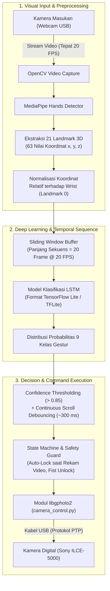

# Roadmap & Rencana Implementasi Tugas Akhir

**Judul Tugas Akhir:**  
> **KONTROL PARAMETER KAMERA BERBASIS HAND GESTURE MENGGUNAKAN MEDIAPIPE-LSTM PADA PERANGKAT EDGE**

* **Mahasiswa:** Hilmy Abid Syafi Abiyyu (NRP 5024 23 1029)  
* **Departemen:** Teknik Komputer FTEIC — Institut Teknologi Sepuluh Nopember (ITS), Surabaya  
* **Dosen Pembimbing:**  
  1. Dr. Eko Mulyanto Yuniarno, S.T., M.T.  
  2. Dr. Diah Puspito Wulandari, S.T., M.Sc.  

---

## 1. Status Progres Terkini (Baseline)

| Komponen / Fitur | Status | File / Modul Terkait | Keterangan Teknis |
| :--- | :---: | :--- | :--- |
| **Koneksi Kamera (Sony ILCE-5000)** | ✅ **Selesai** | [camera_control.py](file:///c:/Hilmy's/Git/camera-control-using-hand-gestures/camera_control.py) | Tersambung stabil via `usbipd` & WSL (libgphoto2), dilengkapi *auto-reconnect*. |
| **Kontrol Parameter Eksposur** | ✅ **Selesai** | [camera_control.py](file:///c:/Hilmy's/Git/camera-control-using-hand-gestures/camera_control.py) | Kontrol nilai **ISO**, **Aperture (f-number)**, dan **Shutter Speed** berhasil. |
| **Pengambilan Foto (*Capture*)** | ✅ **Selesai** | [camera_control.py](file:///c:/Hilmy's/Git/camera-control-using-hand-gestures/camera_control.py) | Menggunakan `trigger_capture()`, auto-download ke folder `hasil_jepretan/`. |
| **Perekaman Video (*Movie*)** | ✅ **Selesai** | [camera_control.py](file:///c:/Hilmy's/Git/camera-control-using-hand-gestures/camera_control.py) | Trigger *start/stop movie* pada kamera digital dan penyimpanan ke `hasil_rekaman/`. |
| **Kontrol Power Zoom** | ⏸️ **Bypass** | [camera_control.py](file:///c:/Hilmy's/Git/camera-control-using-hand-gestures/camera_control.py) | Firmware Sony A5000 membatasi eksekusi zoom via USB (sesuai batasan masalah #4). |
| **MediaPipe Hands Tracking** | ✅ **Selesai** | [test_hand_tracking.py](file:///c:/Hilmy's/Git/camera-control-using-hand-gestures/test_hand_tracking.py) | Pelacakan 21 landmark 3D real-time dengan koreksi orientasi tangan & mode mirror. |
| **Perangkat Lunak Koleksi Dataset** | ✅ **Selesai** | [data_collector.py](file:///c:/Hilmy's/Git/camera-control-using-hand-gestures/data_collector.py) | Full GUI 9 kelas, sampling rate 20 FPS (20 frame/sekuens), tombol hapus sampel (D), dan proteksi auto-cancel. |
| **Perekaman Dataset Mandiri** | ⏳ **Aktif** | `dataset/` | Sedang berlangsung (4/9 kelas tuntas: `snap_photo` 40, `record_video` 40, `lock_unlock` 40, `next_mode` 40). |
| **Pelatihan LSTM & Konversi TFLite**| ⏱️ **Antrean** | `train_lstm.py` | Menunggu dataset Fase 3 terkumpul. |
| **Inferensi Real-Time & Integrasi** | ⏱️ **Antrean** | `main_gesture_control.py` | Menunggu model TFLite Fase 4 selesai. |

---

## 2. Diagram Alur Sistem (Berdasarkan Bab 3 Metodologi)



---

## 3. Rincian Breakdown 6 Fase Pengerjaan

### Fase 1: Perancangan Kelas Gestur & Arsitektur State-Machine (✅ Selesai)
* **Arsitektur:** Menggunakan arsitektur **HCI State Machine dengan Safety Guard** agar interaksi alami, bebas salah pemicu saat vlogging/berbicara, dan akurasi klasifikasi LSTM tinggi (>95%).
* **Matriks 9 Kelas Gestur Dinamis Terpilih:**

| No | Label Kelas | Gerakan Tangan Dinamis | Pemetaan Fungsi Kamera |
| :-: | :--- | :--- | :--- |
| 1 | `rotate_cw` | Pergelangan membuat lingkaran searah jarum jam (jari telunjuk menunjuk) | **Naikkan Nilai (+1)** pada parameter aktif |
| 2 | `rotate_ccw` | Pergelangan membuat lingkaran lawan jarum jam (jari telunjuk menunjuk) | **Turunkan Nilai (-1)** pada parameter aktif |
| 3 | `next_mode` | Menggeser tangan ke atas (*Swipe Up*) | **Ganti Parameter**: [ISO ➔ Aperture ➔ Shutter ➔ Zoom] |
| 4 | `lock_unlock` | Mengepalkan tangan (*Fist ✊*) | **Kunci / Buka Kunci** kontrol sistem |
| 5 | `zoom_in` | 5 jari mekar mengembang keluar (*Pinch Out*) | **Zoom In** |
| 6 | `zoom_out` | 5 jari menguncup rapat ke dalam (*Pinch In*) | **Zoom Out** |
| 7 | `snap_photo` | Gerakan mencubit cepat (*Pinch/Snap*) | **Jepret Foto (*Shutter Release*)** |
| 8 | `record_video` | Pose dua jari (Peace / V-Sign ✌️) | **Mulai / Berhenti Rekam (*Toggle Movie*)** |
| 9 | `idle` | Tangan diam / pose rileks netral | **Netral** (tidak ada perintah) |

#### 🛡️ Mekanisme Keamanan Khusus Perekaman Video (2-Step Video Safety Guard):
* **Latar Masalah HCI:** Pada skenario *solo content creator* / vlogger, pengguna sering kali berbicara sambil menggerakkan tangan secara ekspresif atau berpose 2 jari (peace sign) di depan kamera. Jika gestur ✌️ dapat mematikan rekaman secara langsung tanpa proteksi, risiko *false positive* (rekaman mati mendadak di tengah take) sangat tinggi.
* **Solusi State-Machine (2-Step Safety):**
  1. **Mulai Rekam (Trigger Start):** Lakukan pose ✌️ (`record_video`) $\rightarrow$ Kamera mulai merekam (`is_recording = True`) dan sistem **SEKETIKA AUTO-LOCK** (`is_locked = True`).
  2. **Selama Merekam (Protected State):** Semua gestur kamera (termasuk pose ✌️, zoom, foto, putar nilai) **DIABAIKAN TOTAL**. Konten kreator bebas berpose atau menggerakkan tangan tanpa takut rekaman mati.
  3. **Tahap 1 Buka Kunci (Intentional Fist Unlock):** Lakukan gestur kepalan tangan ✊ (`lock_unlock`) $\rightarrow$ Kunci kontrol terbuka (`is_locked = False`). Indikator GUI/LED beralih ke status *standby stop*.
  4. **Tahap 2 Hentikan Rekaman (Intentional Stop):** Baru setelah kunci terbuka, lakukan pose ✌️ (`record_video`) $\rightarrow$ Perekaman resmi dihentikan (`is_recording = False`) dan file video tersimpan ke storage.
  5. **Auto Re-Lock Timeout (Safety Fail-Safe):** Jika kunci sudah dibuka dengan ✊ namun dalam 5 detik pengguna tidak melakukan pose ✌️ (misal berubah pikiran atau lupa), sistem secara otomatis mengunci kembali (`is_locked = True`).

---

### Fase 2: Pembangunan Perangkat Lunak Akuisisi Dataset (✅ Selesai)
* **File Terwujud:** [data_collector.py](file:///c:/Hilmy's/Git/camera-control-using-hand-gestures/data_collector.py)
* **Karakteristik Teknis:**
  * Ekstraksi 21 koordinat $(x, y, z)$ dinormalisasi relatif terhadap *wrist* (landmark 0) $\rightarrow$ vektor 63 dimensi.
  * Menangkap **20 frame berurutan** per sampel (berdurasi 1.0 detik pada 20 FPS, diselaraskan dengan performa riil Raspberry Pi).
  * Dilengkapi pembatas laju *frame* (50 ms per frame), hitung mundur 3 detik, progress bar visual, penomoran file anti-overwrite, dan tombol pintas `D` / `Backspace` untuk menghapus sampel terakhir yang salah gerak.
  * Menyimpan file array NumPy `(20, 63)` ke dalam folder:
    ```
    dataset/
    ├── rotate_cw/
    ├── rotate_ccw/
    ├── next_mode/
    ├── lock_unlock/
    ├── zoom_in/
    ├── zoom_out/
    ├── snap_photo/
    ├── record_video/
    └── idle/
    ```

---

### Fase 3: Pengumpulan Dataset & Pembagian Data (⏳ Sedang Berjalan)
* **Target Data:** $\pm$ 30–40 sampel sekuens per kelas gestur.
* **Protokol Variasi (Bab 3.1.1 Proposal):**
  * Variasi kecepatan gerakan (santai vs sedang).
  * Variasi jarak terhadap kamera (0.5 meter, 1 meter, hingga 1.5–2 meter).
  * Variasi pencahayaan ruangan (normal dan terang).
* **Data Splitting (Bab 3.1.3 Proposal - Stratified Random Sampling):**
  * **70%** Data Latih (*Training Set*)
  * **15%** Data Validasi (*Validation Set*)
  * **15%** Data Uji (*Testing Set*)

---

### Fase 4: Pelatihan Model LSTM & Konversi TFLite (⏱️ Antrean Berikutnya)
* **Arsitektur Model Deep Learning:**
  * *Input Shape:* `(batch_size, 20, 63)`
  * *LSTM Layers:* 2–3 layer LSTM (misal: 64 unit ➔ 32 unit) dengan *Dropout* (0.2–0.3).
  * *Dense Layer:* Lapisan *Dense Softmax* untuk 9 kelas probabilitas.
* **Evaluasi Metrik (Bab 3.5.1 Proposal):**
  * Akurasi, Precision, Recall, F1-Score, dan grafik *Confusion Matrix*.
* **Ekspor Edge Computing (Raspberry Pi):**
  * Konversi model Keras/TensorFlow ke format **TensorFlow Lite (`.tflite`)** untuk inferensi ringan tanpa GPU.

---

### Fase 5: Sistem Inferensi Real-Time & Logika Debouncing (⏱️ Antrean)
* **Sliding Window Buffer:**
  * Antrean FIFO berkapasitas 20 frame. Setiap frame baru masuk, inferensi TFLite dijalankan berkala.
* **Continuous Scroll & Adaptive Debouncing:**
  * Jeda *cooldown* diatur pada **300 milidetik (~0.3 detik)**.
  * Mengizinkan putaran kontinu: jika tangan terus berputar, angka bergulir cepat (misal ISO: 100 ➔ 200 ➔ 400 ➔ 800 dalam 1 detik).
  * Saat putaran tangan berhenti, nilai langsung diam terkunci pada angka terakhir.

---

### Fase 6: Integrasi Sistem Terpadu & Pengujian Evaluasi TA (⏱️ Antrean)
* **Integrasi End-to-End:**
  * Menghubungkan modul inferensi gestur TFLite dengan [CameraControl](file:///c:/Hilmy's/Git/camera-control-using-hand-gestures/camera_control.py) via USB PTP libgphoto2.
  * Tampilan GUI interaktif: Video webcam, garis landmark, status parameter kamera (ISO, Aperture, Shutter Speed), dan status Lock/Unlock.
* **Pengambilan Data Pengujian untuk Naskah Skripsi (Bab 3.5.2):**
  1. **End-to-End Latency** (milidetik dari gestur selesai hingga kamera Sony merespons).
  2. **Throughput / FPS** sistem pada perangkat edge.
  3. **Tingkat Keberhasilan Eksekusi** pada variasi jarak (1 m, 1.5 m, 2 m) dan kondisi pencahayaan.

---

## 4. Jadwal Target Pengerjaan

| Fase | Target Luaran | Status |
| :---: | :--- | :---: |
| **Fase 1** | Desain 9 kelas gestur & State Machine HCI disepakati | ✅ **Selesai** |
| **Fase 2** | Skrip `data_collector.py` selesai dibuat (Full GUI 9 kelas) | ✅ **Selesai** |
| **Fase 3** | Dataset `dataset/` terkumpul lengkap (30–40 sampel x 9 kelas) | ⏳ **Sedang Berjalan** |
| **Fase 4** | Model LSTM terlatih, file `.tflite` diekspor, dan Confusion Matrix dihasilkan | ⏱️ Antrean |
| **Fase 5** | Inferensi real-time lancar dengan continuous scroll sliding window & debouncing | ⏱️ Antrean |
| **Fase 6** | Integrasi penuh ke `camera_control.py` & pengambilan data tabel skripsi | ⏱️ Antrean |
